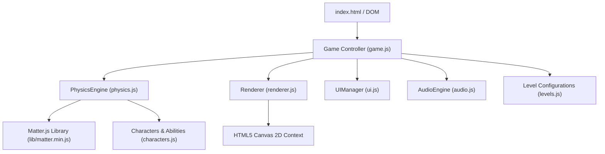

# 🪐 Orbit Blasters — Complete Project Understanding and Viva Guide

> **Prepared for:** B.Tech / B.E. Computer Engineering & IT — Computer Graphics & Game Development Viva Examination  
> **Project Name:** Orbit Blasters — 2D Cartoon Space Physics Game  
> **Source Inspection Date:** October 2026  
> **Files Inspected:** `index.html`, `styles.css`, `package.json`, `README.md`, `lib/matter.min.js`, and all scripts in `src/` (`game.js`, `physics.js`, `characters.js`, `levels.js`, `renderer.js`, `ui.js`, `audio.js`).

---

## Table of Contents
1. [Project Overview](#1-project-overview)
2. [Project Structure and Code Walkthrough](#2-project-structure-and-code-walkthrough)
3. [Computer Graphics and Technical Concepts](#3-computer-graphics-and-technical-concepts)
4. [35 Viva Questions and Answers](#4-viva-questions-and-answers)
5. [Team Study Guide](#5-team-study-guide)
6. [Demo Video & Live Presentation Script](#6-demo-video--live-presentation-script)
7. [Visual Customization and Pre-Viva Checklist](#7-visual-customization-and-pre-viva-checklist)
8. [Final Revision Sheet](#8-final-revision-sheet)

---

## 1. Project Overview

### 1.1 Concept and Theme
**Orbit Blasters** is a 2D physics-driven cartoon trajectory game developed using native **HTML5 Canvas**, **Vanilla JavaScript (ES6+)**, **CSS3**, and **Matter.js** (2D rigid-body physics engine). 

The game takes inspiration from classic projectile puzzle games (like *Angry Birds*), but contextualizes the mechanics in outer space:
- **Theme:** A galactic cosmic defense adventure across three unique worlds (Moon Base, Crystal Planet, and Asteroid Field).
- **Core Narrative:** Players launch four expressive alien creatures (Blasters) from an orbital slingshot to shatter robotic fortresses, detonate volatile TNT canisters, rescue stranded astronauts, and ultimately defeat the **Alien Overlord** in Level 10.
- **Audio Aesthetic:** 100% procedurally synthesized retro-arcade audio via the **Web Audio API** without relying on any external `.mp3` or `.wav` files.

### 1.2 Core Gameplay Loop
1. **Mission Start:** Player selects an unlocked level from the Level Select screen or clicks **PLAY GAME** to start the latest unlocked mission.
2. **Aim & Pull:** The player clicks/touches the active creature sitting in the orbital energy slingshot (`launcherPos = {x: 220, y: 520}`) and drags backwards.
3. **Trajectory Preview:** As the creature is dragged, an analytical 36-step trajectory arc previews the gravitational flight path.
4. **Launch:** Releasing the pointer imparts an instantaneous initial velocity vector ($\vec{v} = \Delta \vec{r} \times \text{powerFactor}$) to the physics body.
5. **Mid-Flight Ability:** While in flight (`state === 'FLIGHT'`), clicking anywhere on the screen or pressing the `Spacebar` activates that specific creature's unique cosmic ability.
6. **Collision & Destruction:** The creature collides with blocks, robots, and explosive canisters. If relative impact velocity exceeds $4.5\text{ px/step}$, damage is dealt. 
7. **Settling & Turn Evaluation:** When the projectile slows down below $0.5\text{ px/s}$ for $1.2\text{ seconds}$ (or after an $8\text{s}$ timeout), the turn completes.
8. **Victory / Defeat:**
   - **Victory:** If all robots (and boss) are destroyed (`robotsLeft === 0`), any remaining astronaut is saved, surplus blasters yield bonus score ($+8000$ points each), star rating ($1$ to $3$ stars) is evaluated, and the next level is unlocked.
   - **Defeat:** If all creatures in the queue are spent while targets remain standing, the defeat modal appears with a retry option.

### 1.3 Confirmed Characters (The 4 Blasters)
Defined in `src/characters.js`:

| Blaster | Role / Archetype | Physical Attributes | Cosmic Ability | Mechanic in Code |
| :--- | :--- | :--- | :--- | :--- |
| **Solar** | *The Solar Spark* | Radius: 20, Density: 0.003, Restitution: 0.35 | **Supernova Burst** | Radial impulse within $220\text{px}$ radius pushing dynamic bodies outward + up to $65$ direct thermal damage + upward lift. |
| **Frost** | *The Glacial Wisp* | Radius: 19, Density: 0.0025, Restitution: 0.30 | **Absolute Zero** | Radial flash freeze ($240\text{px}$ radius). Wipes out friction (`friction = 0.005`), converts structures to brittle ice (`hp = min(hp, 25)`), deals $40$ robot damage. |
| **Gravity** | *The Cosmic Singularity* | Radius: 21, Density: 0.0035, Restitution: 0.20 | **Singularity Pull** | Spawns a $1.8\text{s}$ vortex black hole ($260\text{px}$ radius). Freezes creature in place, pulls all dynamic objects toward center, deals continuous crush damage, then implodes. |
| **Bouncer** | *The Kinetic Surge* | Radius: 18, Density: 0.0028, Restitution: 0.95 | **Kinetic Hyper-Bounce** | Velocity surge ($\ge 28\text{ px/frame}$), restitution boosted to $0.98$, punches through up to $5$ consecutive obstacles with $60$ impact damage per hit. |

### 1.4 Confirmed Targets and Objects
Defined in `src/levels.js` and `src/physics.js`:

1. **Alien Robot Scout:** Circular robot ($\text{radius } 18$, $30\text{ HP}$, $2000\text{ pts}$). Features procedural animated blinking eye that tracks the flying creature.
2. **Alien Robot Brute:** Square fortified robot ($38 \times 38\text{ px}$, $55\text{--}65\text{ HP}$, $3500\text{ pts}$). Armored chassis, heavier mass, angry animated visor.
3. **Alien Overlord (Boss):** Massive circular boss ($\text{radius } 44$, $450\text{ HP}$, $25000\text{ pts}$) in Level 10. Displays an animated glowing forcefield crown and drives the top HUD boss health bar.
4. **Astronauts:** Innocent stranded spacemen ($\text{radius } 18$, $5000\text{ pts}$). Automatically rescued if hit by any body with relative speed $> 1.5$ or upon level completion.
5. **Structural Blocks:** Rectangular rigid bodies built from 5 distinct materials:
   - `wood`: Lightweight, breakable ($\text{density } 0.0016, \text{HP } 40, 400\text{ pts}$).
   - `stone`: Heavy structural pillar ($\text{density } 0.0040, \text{HP } 90, 700\text{ pts}$).
   - `ice`: Low friction, brittle ($\text{density } 0.0012, \text{friction } 0.02, \text{HP } 22, 500\text{ pts}$).
   - `metal`: Ultra dense, high durability ($\text{density } 0.0085, \text{HP } 220, 1000\text{ pts}$).
   - `tnt`: Unstable red explosive canister ($\text{density } 0.0018, \text{HP } 12, 1200\text{ pts}$). Triggers a $220\text{px}$ blast wave with $100$ damage and $0.08$ impulse force.

### 1.5 Confirmed Worlds & 10 Playable Levels
1. **World 1: Moon Base (Levels 1–3)**
   - Dark navy space backdrop, Earth in distance, cratered moon surface.
   - Levels: *First Launch* (Level 1), *Crumbling Towers* (Level 2 with TNT introduction), *Rescue Mission* (Level 3 with Astronaut).
2. **World 2: Crystal Planet (Levels 4–7)**
   - Deep violet/magenta cosmic nebula, jagged crystal mountain terrain.
   - Levels: *Crystal Fortress* (Level 4), *Deep Freeze* (Level 5 introduces Frost), *Singularity* (Level 6 introduces Gravity), *Dual Outposts* (Level 7).
3. **World 3: Asteroid Field (Levels 8–10)**
   - Crimson/amber nebula, ringed gas giant planet, floating asteroid platforms.
   - Levels: *Armored Bastion* (Level 8 introduces metal armor), *Cosmic Collapse* (Level 9 multi-tier citadel), *Alien Overlord* (Level 10 Boss showdown).

### 1.6 Controls
- **Mouse / Touch Drag & Release:** Aim and launch blaster.
- **Mouse Click / Spacebar (Mid-Flight):** Activate character ability.
- **R Key / Restart Button:** Instantly restart the current level.
- **P Key / Escape Key / Pause Button:** Toggle Pause modal.
- **M Key / Mute Button:** Toggle Web Audio sound and synthesized music.

---

## 2. Project Structure and Code Walkthrough

```
Cg project/
├── index.html               # Canvas container, HUD overlays, SVGs, modals
├── styles.css               # Modern glassmorphism UI, typography, HUD layouts
├── package.json             # Scripts (npm start -> python3 -m http.server 8000)
├── README.md                # Project documentation & feature summaries
├── lib/
│   └── matter.min.js        # Vendored Matter.js 2D physics engine (v0.20.0)
└── src/
    ├── game.js              # State machine, input mapping, master game loop
    ├── physics.js           # Matter.js integration, collisions, damage, trajectory
    ├── characters.js        # 4 Blaster profiles and cosmic ability implementations
    ├── levels.js            # 10 Level layout schemas, coordinates, structures, targets
    ├── renderer.js          # Canvas 2D rendering, camera lerp, procedural sprites, VFX
    ├── ui.js                # DOM screens, level select, modals, localStorage persistence
    └── audio.js             # Web Audio API real-time synthesizer (SFX & music)
```

### 2.1 File Responsibilities & Key Functions



#### 1. `src/game.js` (Master Controller)
- **Role:** Holds the top-level game state (`MENU`, `LOADING`, `AIMING`, `FLIGHT`, `SETTLING`, `COMPLETE`, `OVER`), binds user input events, and drives the fixed-step game loop.
- **Key Functions:**
  - `startLoop()`: Starts `requestAnimationFrame(loop)`, calculates delta time (`dt`), steps physics and renderer.
  - `screenToWorld(clientX, clientY)`: Maps raw screen cursor pixels into the zoomable, movable game world coordinates using the camera's translation and zoom.
  - `onPointerDown(e)`, `onPointerMove(e)`, `onPointerUp()`: Implements the slingshot aiming drag gesture with radius clamping (`maxDragDistance = 110`).
  - `startLevel(levelId)`: The single source of truth for level switching. Resets physics, spawns blocks/robots/astronauts, sets `_initPhaseTimer`, and configures the HUD.
  - `onTurnComplete()`: Checks remaining robots, grants remaining blaster surplus bonus ($+8000$), evaluates stars, and triggers victory or defeat.

#### 2. `src/physics.js` (Physics & Collision Subsystem)
- **Role:** Interfaces directly with Matter.js; handles dynamic body creation, collision detection events, damage application, impulse distribution, and trajectory forecasting.
- **Key Functions:**
  - `init()`: Builds `Matter.Engine.create({ gravity: { x: 0, y: 1.0, scale: 0.001 } })`.
  - `createBlock()`, `createRobot()`, `createBoss()`, `createAstronaut()`: Instantiates rigid bodies with explicit mass, density, friction, and custom game properties (`hp`, `maxHp`, `gameType`).
  - `launchCreature(charId, startPos, velocity)`: Spawns the flying projectile circle body with initial impulse.
  - `setupCollisionEvents()`: Listens to `collisionStart`. Evaluates relative impact velocity $\Delta v$. Suppresses damage during `_initPhaseTimer` to prevent tower collapse on spawn.
  - `_applyDamageWithCooldown(body, amount, now)`: Throttles multi-hit collision glitches via an 80ms per-body cooldown map (`_damageCooldowns`).
  - `triggerExplosion(x, y, radius, force, directDamage)`: Queries dynamic bodies within radius, applies radial force vectors scaled by distance factor, and deals blast damage.
  - `predictTrajectory(startPos, velocity, steps)`: Analytical numerical simulation step loop calculating parabolic points until ground impact ($y = 600$).

#### 3. `src/characters.js` (Blaster Definitions & Powers)
- **Role:** Data dictionary (`CHARACTERS`) holding physical constants (radius, density, friction, restitution) and custom function `activateAbility(game, creatureBody)`.
- **Key Functions:**
  - `solar.activateAbility`: Computes distance to all dynamic bodies; applies radial force impulse $F = \text{blastForce} \times (1 - \frac{d}{R}) \times \text{mass}$ and thermal damage.
  - `frost.activateAbility`: Flash freezes blocks in $240\text{px}$ radius (`friction = 0.005`, `materialType = 'ice'`).
  - `gravity.activateAbility`: Calls `game.physics.addVortex()`, stopping the creature as singularity anchor.
  - `bouncer.activateAbility`: Multiplies speed, increases restitution to $0.98$, sets punch-through bounce count.

#### 4. `src/levels.js` (Level Layouts & Geometries)
- **Role:** Pure data configuration defining all 10 levels. Ground level is standardized at $y = 600$.
- **Design Rule:** A block of height $h$ centered at $y$ has its base at $y + \frac{h}{2}$. Therefore, the lowest ground block sits at $y = 600 - \frac{h}{2}$ (e.g., $y = 540$ for $h = 120$). This avoids spawning blocks inside the ground floor.

#### 5. `src/renderer.js` (Graphics & Visual Effects Engine)
- **Role:** Draws all visuals onto the 2D Canvas context. Handles high-DPI scaling, camera matrix transformations, parallax starfields, and 100% procedural cartoon character/robot rendering.
- **Key Functions:**
  - `render(game, dt)`: Main render pass. Updates camera, clears screen, renders background, pushes world transformation matrix, draws entities, particles, shockwaves, floating text, and restores matrix.
  - `updateCamera(game, dt)`: Smoothly interpolates (`lerp`) camera coordinates toward target (tracking creature during flight, slingshot during aim, or battlefield center when idle).
  - `renderBackground(game, shakeX, shakeY)`: Multi-layer gradient background with distant celestial bodies (Earth, nebulae, Saturn-like ringed planet) and twinkling parallax stars.
  - Procedural artists: `renderCreatureBody()`, `renderRobots()`, `renderBlocks()`, `renderSlingshotBack/Front()`, `renderTrajectory()`.

#### 6. `src/ui.js` (User Interface & Persistence)
- **Role:** Manages DOM overlays, modal popups, audio icon toggles, level selector generation, star calculation, and browser persistence.
- **Key Functions:**
  - `loadProgression()` & `saveProgression()`: Reads and writes `unlockedLevel`, `scores`, and `stars` dictionaries to browser `localStorage`.
  - `showVictory()`, `showDefeat()`, `showPause()`: Modulates CSS classes (`hidden`, `flex-center`) and updates summary stats.

#### 7. `src/audio.js` (Web Audio Synthesizer)
- **Role:** Generates interactive audio purely with code via `AudioContext`.
- **Key Functions:**
  - `playSlingshotStretch(fraction)`: Frequency sweep oscillator mimicking rubber tension.
  - `playLaunch()`: Fast downward frequency chirp for launch impulse.
  - `playImpact(material, intensity)`: Frequency and filter tuned to wood, stone, ice, metal, or flesh.
  - `playExplosion()`: Low-pass filtered noise buffer with exponential gain decay.
  - `startAmbientMusic()`: Multi-oscillator ambient chord progression running in the background.

---

### 2.2 Execution Flow Walkthrough

```mermaid
sequenceDiagram
    autonumber
    actor Player
    participant Canvas as Canvas / Input
    participant Game as Game (game.js)
    participant Physics as PhysicsEngine (physics.js)
    participant Matter as Matter.js
    participant Renderer as Renderer (renderer.js)
    participant UI as UIManager (ui.js)

    Player->>Canvas: Drag creature backward on slingshot
    Canvas->>Game: onPointerDown() & onPointerMove()
    Game->>Physics: predictTrajectory(launcherPos, velocity)
    Game->>Renderer: Trajectory dots drawn on screen
    Player->>Canvas: Release mouse button
    Canvas->>Game: onPointerUp()
    Game->>Physics: launchCreature() -> creates dynamic body
    Game->>Game: Set state = 'FLIGHT'
    Game->>UI: showAbilityBanner()
    opt Player triggers ability (Click / Spacebar)
        Player->>Game: Spacebar / Click
        Game->>Game: triggerCurrentAbility()
        Game->>Physics: Apply radial force / vortex / freeze
    end
    loop Game Loop (requestAnimationFrame)
        Game->>Physics: update(dt) -> steps Matter.js engine
        Physics->>Matter: collisionStart event fired
        Physics->>Physics: Calculate relSpeed; applyDamage(body, dmg)
        Game->>Renderer: render(game, dt) -> Camera follows projectile
    end
    Physics->>Physics: Velocity < 0.5 for 1.2s -> destroyProjectile()
    Physics->>Game: onTurnComplete()
    alt All robots destroyed
        Game->>UI: showVictory(score, stars)
    else Robots remain & creatures left
        Game->>Game: Queue next creature; state = 'AIMING'
    else Robots remain & no creatures left
        Game->>UI: showDefeat(robotsLeft, score)
    end
```

---

## 3. Computer Graphics and Technical Concepts

### 3.1 Technology Stack & Frameworks
- **Primary Language:** JavaScript (ES6+ Classes, Arrow Functions, Destructuring).
- **Graphics API:** HTML5 Canvas 2D Rendering Context (`CanvasRenderingContext2D`).
- **Physics Library:** Matter.js (v0.20.0, vendored locally in `lib/matter.min.js`).
- **Audio System:** Web Audio API (`AudioContext`, `OscillatorNode`, `BiquadFilterNode`, `GainNode`).
- **UI & Styling:** Vanilla CSS3 (Custom Properties, Flexbox, Glassmorphism, CSS Transitions/Keyframes).

---

### 3.2 Coordinate Systems and Transformations

```
Screen Space (Pixels)               World Space (Game Battlefield)
(0,0) ──────────────► +X            (0,0) ─────────────────────────► +X
  │                                   │
  │     [Canvas: 1280x720]            │   Ground Line (y = 600)
  ▼ +Y                                ▼ +Y
```

#### Screen Space vs. World Space
1. **Screen Coordinates:** Measured in device pixels from top-left $(0, 0)$ to $(W, H)$. Affected by browser window size and CSS layout.
2. **World Coordinates:** The virtual 2D physics plane where structures and characters live. In Orbit Blasters, the ground baseline is fixed at $y = 600$, the launcher is at $(220, 520)$, and target fortresses sit between $x = 750$ and $x = 1200$.

#### Transformation Matrix Pipeline
In `src/renderer.js` (`render()` method), the canvas transformation pipeline converts world coordinates into screen coordinates using translation, scaling, and screen shake:

```javascript
ctx.save();
// 1. High-DPI Display Scaling
ctx.scale(this.dpr, this.dpr);

// 2. Camera Translation & Screen Shake (Centered viewport)
ctx.translate(this.width / 2 + shakeX, this.height / 2 + shakeY);

// 3. Zoom Transformation
ctx.scale(this.camera.zoom, this.camera.zoom);

// 4. World Pan Translation
ctx.translate(-this.camera.x, -this.camera.y);

// ... Render all world objects (blocks, robots, characters) ...
ctx.restore();
```

#### Screen-to-World Coordinate Inversion
When the player clicks the screen, `onPointerDown(e)` must convert mouse pixel coordinates $(x_{\text{screen}}, y_{\text{screen}})$ into world physics coordinates $(x_{\text{world}}, y_{\text{world}})$. In `src/game.js`:

$$\begin{aligned}
x_{\text{world}} &= \frac{x_{\text{screen}} - \frac{\text{width}}{2}}{\text{zoom}} + x_{\text{camera}} \\
y_{\text{world}} &= \frac{y_{\text{screen}} - \frac{\text{height}}{2}}{\text{zoom}} + y_{\text{camera}}
\end{aligned}$$

---

### 3.3 Camera System & Linear Interpolation (Lerp)
To prevent disorienting camera snaps, `updateCamera` in `src/renderer.js` uses **Linear Interpolation (Lerp)** to smoothly glide toward its target position:

$$P_{\text{current}} = P_{\text{current}} + (P_{\text{target}} - P_{\text{current}}) \times \alpha$$

Where $\alpha = 0.08$ is the smoothing factor per frame.
- When aiming, the camera targets the slingshot: $(400, 440), \text{zoom } 1.0$.
- In flight, the camera tracks the creature with a velocity-based lead:
  $$x_{\text{target}} = x_{\text{proj}} + v_x \times 12, \quad y_{\text{target}} = y_{\text{proj}} + v_y \times 8, \quad \text{zoom } 0.92$$
- When settled, the camera centers on the entire battlefield: $(680, 420), \text{zoom } 0.88$.

---

### 3.4 Procedural Vector Drawing Techniques
No external sprite sheets or `.png` images are loaded for characters or robots. Everything is drawn procedurally on Canvas 2D:
- **Character Bodies:** Radial gradients (`createRadialGradient`) establish spherical 3D shading, glossy highlight arcs (`ctx.arc`), and cartoon expressions.
- **Eyes & Tracking:** In `src/renderer.js`, creature and robot pupils calculate the directional angle to their target using `Math.atan2(dy, dx)`:
  $$\theta = \text{atan2}(y_{\text{target}} - y_{\text{eye}}, x_{\text{target}} - x_{\text{eye}})$$
  Pupil position is displaced by $r \cos\theta$ and $r \sin\theta$, giving characters a lifelike responsive gaze!
- **Damage Cracks:** Destructible blocks draw jagged hairline fracture lines proportional to damage received: $\text{damageRatio} = 1 - \frac{\text{hp}}{\text{maxHp}}$.

---

### 3.5 Projectile Motion & Trajectory Prediction

#### The Slingshot Physics Equation
When dragged backwards from resting position $\vec{P}_{\text{launcher}}$ to $\vec{P}_{\text{drag}}$, the launch displacement vector is:
$$\Delta x = x_{\text{launcher}} - x_{\text{drag}}, \quad \Delta y = y_{\text{launcher}} - y_{\text{drag}}$$

The launch velocity vector is scaled by `launchPowerFactor` ($0.22$):
$$\vec{v}_0 = \begin{pmatrix} v_x \\ v_y \end{pmatrix} = \begin{pmatrix} \Delta x \times 0.22 \\ \Delta y \times 0.22 \end{pmatrix}$$

#### Analytical Trajectory Simulation (Euler Integration)
In `src/physics.js` (`predictTrajectory`), the arc is computed forward in time across 36 discrete steps:
$$\begin{aligned}
x_{t+1} &= x_t + v_x \\
y_{t+1} &= y_t + v_y \\
v_{y, t+1} &= v_{y, t} + g_{\text{step}}
\end{aligned}$$
Where $g_{\text{step}} = 1.0 \times 0.001 \times \frac{1000}{60} = \frac{1}{60} \approx 0.0167\text{ px/step}^2$.

---

### 3.6 Collision Detection and Response (Matter.js)

#### Collision Detection
1. **Broadphase:** Matter.js prunes non-colliding pairs using Axis-Aligned Bounding Box (AABB) sweeps to avoid expensive $O(N^2)$ checks.
2. **Narrowphase (Separating Axis Theorem - SAT):** For convex polygons (blocks) and circles (creatures, robots), Matter.js projects vertices onto potential separating axes. If an axis exists with no overlap, the objects do not collide. The minimum overlap vector defines the **Collision Normal** and **Penetration Depth**.

#### Collision Event Handling & Damage Model
In `src/physics.js` (`setupCollisionEvents`):
1. **Relative Velocity:**
   $$v_{\text{rel}} = \sqrt{(v_{x,A} - v_{x,B})^2 + (v_{y,A} - v_{y,B})^2}$$
2. **Damage Formula:** Resting objects ($\le 4.5\text{ px/step}$) take zero damage. If impact speed exceeds $4.5$, structural damage is proportional to surplus kinetic energy:
   $$\text{Damage} = \text{round}\left( (v_{\text{rel}} - 4.5) \times 8 \right)$$
3. **Cooldown Guard:** `_damageCooldowns` prevents a single collision contact from dealing damage multiple times across consecutive frames ($80\text{ms}$ cooldown).
4. **Init-Phase Guard:** Spawning structures require $\sim 1.8\text{ seconds}$ to settle under gravity. During `_initPhaseTimer > 0`, all collision damage and explosions are suppressed to avoid pre-game collapse.

---

## 4. 35 Viva Questions and Answers

### Category 1: Project Overview & Objectives

#### Q1: What is Orbit Blasters, and what is its primary technical objective?
> **Answer:** "Orbit Blasters is a 2D physics-based cartoon trajectory game developed in vanilla JavaScript and HTML5 Canvas with Matter.js. The objective is to demonstrate 2D computer graphics principles—such as real-time canvas transformations, dynamic camera lerping, particle systems, procedural sprite rendering, and rigid-body Newtonian physics—in a cohesive, playable 10-level game."

#### Q2: What inspired the gameplay, and how does it differ from traditional slingshot games?
> **Answer:** "While inspired by classic games like *Angry Birds*, Orbit Blasters introduces a space-exploration theme with four distinct cosmic abilities (thermal supernova blast waves, absolute-zero flash freezes that wipe out friction, gravity singularity vortices, and kinetic hyper-ricochet) alongside real-time procedural Web Audio sound synthesis."

#### Q3: How many levels and worlds are implemented in the project?
> **Answer:** "There are 10 playable levels across 3 worlds: Moon Base (Levels 1–3), Crystal Planet (Levels 4–7), and Asteroid Field (Levels 8–10). Level 10 culminates in a boss fight against the Alien Overlord."

#### Q4: How does a player win or lose a level?
> **Answer:** "A level is won when all alien robots (and the boss in Level 10) have their health reduced to zero. Unused creatures in the queue grant a surplus bonus of $+8000$ points each. A level is lost if all creatures in the queue have been launched and at least one enemy robot remains standing."

#### Q5: Are game assets (like characters and textures) loaded from external image files?
> **Answer:** "No external image files or sprite sheets are used. All characters, robots, structures, UI icons, and planetary backgrounds are rendered 100% procedurally using the HTML5 Canvas 2D API."

---

### Category 2: Computer Graphics & Rendering

#### Q6: How does the game maintain a smooth 60 FPS animation loop?
> **Answer:** "The loop is driven by `requestAnimationFrame(loop)` in `src/game.js`. It passes high-resolution timestamps from `performance.now()`. Delta time (`dt`) is calculated and clamped between $1\text{ms}$ and $50\text{ms}$ to prevent physics explosion or frame skips if the browser tab loses focus."

#### Q7: How does the canvas handle high-DPI (Retina) displays without blurriness?
> **Answer:** "In `src/renderer.js`, we query `window.devicePixelRatio`. We scale the internal canvas pixel dimensions by `dpr` (`canvas.width = rect.width * dpr`), and then apply `ctx.scale(dpr, dpr)` on the context so all coordinate math remains intuitive in CSS pixels while rendering at native display sharpness."

#### Q8: How does the camera system work in Orbit Blasters?
> **Answer:** "The camera in `src/renderer.js` maintains position $(x, y)$, zoom level, and screen shake offset. Every frame, it uses Linear Interpolation (Lerp) with a rate of $0.08$ to smoothly follow the active projectile or center on the battlefield. It then applies `ctx.translate()` and `ctx.scale()` before rendering world entities."

#### Q9: What is Screen-to-World coordinate transformation, and where is it used?
> **Answer:** "Screen coordinates are raw pixel offsets on the monitor, while world coordinates are physics positions in the game. In `src/game.js` (`screenToWorld`), we invert the camera's translation and zoom so that mouse clicks on the screen accurately map to dragging the slingshot in the physics world."

#### Q10: How are the parallax space backgrounds implemented?
> **Answer:** "In `src/renderer.js` (`renderBackground`), stars and distant planets are drawn with velocity factors proportional to camera movement. Foreground stars move faster while distant nebulae and planets move at a fraction (e.g., `0.04 * camX`), creating a sense of depth."

#### Q11: How is the visual particle system constructed?
> **Answer:** "In `src/renderer.js`, particle pools manage sparks, smoke, debris, shockwaves, and floating score texts. Each particle updates position by velocity, applies gravity/friction, decreases opacity/life, and is culled when life reaches zero."

#### Q12: How are character facial animations and eyes drawn?
> **Answer:** "Characters are drawn using layered arcs and radial gradients. Eyes calculate the angle to their target using `Math.atan2(dy, dx)`. The pupils are offset along that vector so characters dynamically look toward where they are aiming or flying."

---

### Category 3: Physics & Collision Handling

#### Q13: Which physics engine is used, and what does it handle?
> **Answer:** "We use **Matter.js** (v0.20.0), a 2D rigid body physics engine. It handles rigid body dynamics, numerical integration, gravitational acceleration, momentum transfer, and collision detection."

#### Q14: How does the slingshot predict the trajectory arc before launching?
> **Answer:** "In `src/physics.js` (`predictTrajectory`), an analytical Euler forward simulation calculates 36 discrete $(x, y)$ positions using the launch velocity and world gravity. The arc draws as dotted guides and stops if it intersects the ground baseline at $y = 600$."

#### Q15: How does collision detection work in Matter.js?
> **Answer:** "Matter.js uses an AABB broadphase to quickly filter out non-touching bodies, followed by the **Separating Axis Theorem (SAT)** for narrowphase detection between convex polygons and circles to find contact points, normals, and penetration depths."

#### Q16: How is collision damage calculated?
> **Answer:** "In `src/physics.js` (`setupCollisionEvents`), we calculate the relative velocity between colliding bodies: $\Delta v = \text{hypot}(v_{x,A} - v_{x,B}, v_{y,A} - v_{y,B})$. Impacts below $4.5\text{ px/step}$ are ignored as resting friction. Above $4.5$, damage is computed as $(\Delta v - 4.5) \times 8$."

#### Q17: What was the 'tower spawn collapse' issue, and how did you fix it?
> **Answer:** "When complex towers spawned at level start, slight initial micro-movements caused false collision damage, collapsing structures before the player even aimed. We solved this by implementing `_initPhaseTimer = 1800ms` in `src/physics.js` during which all collision damage and explosions are suppressed while bodies settle."

#### Q18: How does the game prevent duplicate damage glitches in a single collision?
> **Answer:** "We implemented `_applyDamageWithCooldown` with a per-body cooldown map (`_damageCooldowns`). Once a body takes collision damage, it cannot take further damage for $80\text{ms}$, preventing multi-frame damage loops."

#### Q19: How are explosions handled in physics?
> **Answer:** "In `src/physics.js` (`triggerExplosion`), we query all dynamic bodies within the blast radius. We calculate a distance falloff factor $(1 - \frac{d}{R})$, apply a radial force vector via `Matter.Body.applyForce()`, and deal scaled explosion damage."

#### Q20: How does the game know when a player's turn has finished?
> **Answer:** "In `src/physics.js` (`checkSettling`), if the projectile's speed drops below $0.5\text{ px/s}$ for $1.2$ continuous seconds after at least $1$ second in flight, or if an $8$-second maximum timeout is reached, the projectile is removed and `onTurnComplete()` is triggered."

---

### Category 4: Abilities & Character Mechanics

#### Q21: How does Solar's 'Supernova Burst' work?
> **Answer:** "In `src/characters.js`, Solar emits a thermal blast in a $220\text{px}$ radius. It applies an outward radial impulse to all surrounding dynamic bodies, an upward lift force, and up to $65$ direct thermal damage."

#### Q22: How does Frost's 'Absolute Zero' ability operate?
> **Answer:** "Frost emits a freezing flash in a $240\text{px}$ radius. It sets block friction to near zero ($0.005$), converts their material to ice, and caps their HP to $25$, making the structure slide and shatter under its own weight."

#### Q23: How does Gravity's 'Singularity Pull' work in the physics engine?
> **Answer:** "Gravity anchors the creature in place and registers an active vortex in `src/physics.js`. For $1.8\text{ seconds}$, every physics update pulls nearby dynamic bodies toward the singularity center with force proportional to mass and distance, ending with a violent implosion."

#### Q24: How does Bouncer's 'Kinetic Hyper-Bounce' function?
> **Answer:** "Bouncer surges forward at high speed ($\ge 28\text{ px/frame}$) with restitution set to $0.98$. It punches through up to $5$ consecutive obstacles, dealing $60$ damage on contact while ricocheting off walls and floors."

---

### Category 5: Architecture, UI & Audio

#### Q25: How does the state machine in `src/game.js` prevent illegal actions?
> **Answer:** "The game has mutually exclusive states: `MENU`, `LOADING`, `AIMING`, `FLIGHT`, `SETTLING`, `COMPLETE`, and `OVER`. For example, slingshot dragging is only permitted in `AIMING`, abilities can only be activated in `FLIGHT`, and user input is locked during `LOADING`."

#### Q26: How does the game persist player progress across browser sessions?
> **Answer:** "In `src/ui.js`, player progression is saved using `localStorage`. It stores `unlockedLevel`, high scores per level, and star ratings as JSON strings, automatically loading them whenever the page refreshes."

#### Q27: How does the audio system work without external sound files?
> **Answer:** "In `src/audio.js`, the Web Audio API synthesizes all sounds mathematically. Oscillator nodes generate sine, triangle, and sawtooth waves for chirps and stretching sounds, while random noise buffer generators pass through low-pass filters to create explosions."

#### Q28: How does the HUD remain responsive across screen sizes?
> **Answer:** "The HUD uses semantic HTML overlays positioned on top of the canvas via absolute positioning, CSS Flexbox, and viewport units (`100vw`, `100vh`), maintaining full usability whether on desktop or laptop displays."

---

### Category 6: Engineering Challenges, Limitations & Improvements

#### Q29: What was a major concurrency/timing challenge with Matter.js?
> **Answer:** "Removing physics bodies directly inside a collision callback corrupted Matter's internal composite tree during step iterations. We resolved this by wrapping body removals inside `requestAnimationFrame()` to defer removal until the current physics sub-step completes."

#### Q30: What is the purpose of fixed substepping in `PhysicsEngine.prototype.update`?
> **Answer:** "Variable frame times cause physics inaccuracies. We divide delta time into fixed sub-steps of $16.667\text{ms}$ (60 FPS equivalent). This guarantees deterministic trajectory calculations and prevents objects from tunneling through walls."

#### Q31: What are the current limitations of the game?
> **Answer:** "Current limitations include: 1) The game is strictly 2D flat physics; 2) Physics calculations run on the main CPU thread rather than Web Workers; 3) Level designs are hardcoded in `levels.js` rather than loaded from an external visual level editor."

#### Q32: How would you add a new character or ability?
> **Answer:** "You simply add a new key into the `CHARACTERS` object in `src/characters.js` specifying its radius, density, restitution, colors, and an `activateAbility(game, creatureBody)` function, and then add its ID into the desired level's `creatures` array in `src/levels.js`."

#### Q33: How could performance be further optimized for lower-end devices?
> **Answer:** "We could implement offscreen canvas pre-rendering for complex static background scenery, clamp maximum particle counts, and run the physics loop in a dedicated background Web Worker."

#### Q34: What mathematical formula governs the slingshot rubber band rendering?
> **Answer:** "Quadratic Bézier curves (`ctx.quadraticCurveTo`). The control point is dynamically positioned at the creature's center during dragging, creating a curved elastic band appearance that connects to the front and back posts."

#### Q35: If the external internet is disconnected, will Orbit Blasters still run?
> **Answer:** "Yes! Matter.js is locally vendored in `lib/matter.min.js`, audio is synthesized via the browser's built-in Web Audio API, and graphics are drawn procedurally. Only Google Fonts are fetched externally, but CSS has system font fallbacks (`-apple-system`, `sans-serif`)."

---

## 5. Team Study Guide

### 5.1 The 60-Second Elevator Pitch (Memorize This!)
> *"Orbit Blasters is a 2D space physics puzzle game built with native HTML5 Canvas, Vanilla JavaScript, and Matter.js. Players launch four unique cosmic creatures from an orbital slingshot to demolish alien robot fortifications across 10 levels and 3 worlds. All visual assets and starfields are rendered 100% procedurally with zero external images, and retro sound effects are synthesized in real time via the Web Audio API. Our physics engine incorporates Newton's laws, impulse conservation, trajectory forecasting, and the Separating Axis Theorem for collision response."*

### 5.2 Team Topic Distribution

| Teammate | Focus Area | Files to Master | Core Viva Questions |
| :--- | :--- | :--- | :--- |
| **Member 1 (Lead / Architecture)** | Game loop, state machine, input mapping, level progression | `src/game.js`, `src/levels.js`, `src/ui.js` | Q1, Q4, Q6, Q9, Q25, Q26 |
| **Member 2 (Graphics & Audio)** | Canvas 2D API, transformations, camera lerp, procedural sprites, Web Audio | `src/renderer.js`, `src/audio.js`, `styles.css` | Q5, Q7, Q8, Q10, Q11, Q12, Q27, Q34 |
| **Member 3 (Physics & Collisions)** | Matter.js integration, SAT collision, damage formula, trajectory math, abilities | `src/physics.js`, `src/characters.js`, `lib/matter.min.js` | Q13, Q14, Q15, Q16, Q17, Q18, Q19, Q20, Q30 |

### 5.3 10-Minute Team Mock Viva Drill
1. **Tester asks:** *"Show me where camera lerping happens."*  
   **Answer:** Open `src/renderer.js` at line 115: `this.camera.x += (this.camera.targetX - this.camera.x) * lerpRate;`
2. **Tester asks:** *"How does the game prevent towers from collapsing on start?"*  
   **Answer:** Open `src/physics.js` at line 27: `_initPhaseTimer` suppresses collision damage for $1.8\text{ seconds}$.
3. **Tester asks:** *"Where is trajectory predicted?"*  
   **Answer:** Open `src/physics.js` at line 588: `predictTrajectory()` runs an analytical Euler forward simulation loop.

---

## 6. Demo Video & Live Presentation Script

**Total Duration:** ~90 seconds

### Step-by-Step Script:
1. **[00:00 - 00:15] Title Screen & Mission Selection**  
   - *"Hello professors. This is **Orbit Blasters**, a 2D physics adventure game built with HTML5 Canvas and Matter.js. Notice our animated menu with procedurally styled characters. Clicking 'Play Game' initiates Level 1 on Moon Base."*
2. **[00:15 - 00:35] Aiming, Trajectory & Solar Ability Launch**  
   - *"As I click and drag Solar on the slingshot, you can see our analytical trajectory prediction arc calculated in real-time. Releasing the mouse launches Solar under gravitational acceleration. Now, by clicking mid-flight, I trigger Solar's Supernova Burst—unleashing a radial impulse shockwave that topples the wooden tower and crushes the robot scout!"*
3. **[00:35 - 00:55] Level 2: Chain Reactions & Explosive TNT**  
   - *"Advancing to Level 2, we introduce stone blocks and TNT canisters. Hitting the central TNT pod creates a devastating chain reaction, blasting the stone pillars outward. Notice the screen shake, particle debris, and floating score popups rendered by our Canvas VFX engine."*
4. **[00:55 - 01:15] Level 6: Frost & Gravity Singularities**  
   - *"In later worlds like Crystal Planet, we can launch Gravity. When I press the Spacebar, Gravity spawns an active black hole vortex that pulls all nearby dynamic bodies inward, dealing crush damage before collapsing into an implosion."*
5. **[01:15 - 01:30] Level 10: Alien Overlord Boss & Victory**  
   - *"Finally, in Level 10, we face the Alien Overlord. The boss features a multi-hit health bar in the top HUD. Defeating the Overlord rescues the captive astronaut, awards star ratings, and registers high scores in browser localStorage."*

---

## 7. Visual Customization and Pre-Viva Checklist

### 7.1 Visual Customization Guide

| Element | Source File & Function | Safe to Change? | Impact / Warning |
| :--- | :--- | :--- | :--- |
| **Character Colors** | `src/characters.js` (`color`, `accentColor`, `glowColor`) | **Visual Only** | Fully safe; immediately changes creature rendering & trail colors. |
| **Character Radii** | `src/characters.js` (`radius`) | ⚠️ **Affects Gameplay** | Changes collision hull size in Matter.js; could affect tight gap fitting. |
| **Background Colors** | `src/renderer.js` (`renderBackground`) | **Visual Only** | Fully safe; edit sky gradients, star counts, or nebulae colors. |
| **Block Textures** | `src/renderer.js` (`renderBlocks`) | **Visual Only** | Fully safe; edit stroke styles, fill colors, and wood/stone grain patterns. |
| **UI Themes & Fonts** | `styles.css` (`:root` variables) | **Visual Only** | Fully safe; modify accent colors (`--accent-gold`, `--accent-cyan`). |
| **Block Dimensions** | `src/levels.js` (`structures` array) | ⚠️ **Affects Gameplay** | Modifies tower physics stability. Ensure bottom $y + \frac{h}{2} \le 600$. |

---

### 7.2 Pre-Viva Technical Checklist
- [ ] **Local Server Verified:** Run `python3 -m http.server 8000` from the project directory.
- [ ] **Correct URL:** Ensure the browser URL is **`http://localhost:8000`** (NOT `https://` and NOT `http://[::]:8000`).
- [ ] **Console Error Free:** Open Chrome/Safari Developer Tools (`F12` or `Cmd+Option+I`) and check Console tab for zero uncaught errors.
- [ ] **Audio Enabled:** Click once anywhere on screen to allow browser AudioContext initialization. Test mute button (`M`).
- [ ] **Slingshot Drag Test:** Verify click-and-drag displays trajectory dots and fires properly.
- [ ] **Ability Test:** Press `Spacebar` while projectile is airborne to verify ability trigger and VFX shockwaves.
- [ ] **Restart Test:** Press `R` to ensure instant level reload.
- [ ] **Fullscreen / Canvas Resize:** Resize window to verify high-DPI scaling dynamically adjusts without visual distortion.

---

## 8. Final Revision Sheet

### Top 5 Files to Understand Inside Out:
1. **`src/physics.js`**: Core Matter.js engine setup, collision events, damage equation, trajectory math.
2. **`src/game.js`**: Game loop (`requestAnimationFrame`), state machine, input coordinate mapping.
3. **`src/renderer.js`**: Canvas 2D context, camera transformation pipeline, procedural sprite drawing.
4. **`src/characters.js`**: The 4 blasters and their mathematical ability implementations.
5. **`src/levels.js`**: 10 level schemas, structure geometries, ground math ($y = 600$).

### Top 10 High-Probability Viva Questions & Quick Answers:

| No. | Question | Rapid Answer |
| :---: | :--- | :--- |
| **1** | How is the game rendered? | HTML5 Canvas 2D API (`ctx`) driven by `requestAnimationFrame`. |
| **2** | Which physics engine is used? | Matter.js (v0.20.0 2D rigid-body engine). |
| **3** | How are trajectories predicted? | Analytical Euler integration stepping forward in time with gravity ($36$ steps). |
| **4** | What collision algorithm is used? | Separating Axis Theorem (SAT) for convex polygons/circles. |
| **5** | How is collision damage determined? | If relative speed $\Delta v > 4.5$, $\text{damage} = (\Delta v - 4.5) \times 8$. |
| **6** | How are character images loaded? | No image files! 100% procedurally drawn using canvas arcs, paths, and gradients. |
| **7** | How does the camera follow the player? | Smooth linear interpolation (`lerp`) with a $0.08$ rate toward creature velocity lead. |
| **8** | How is audio generated? | Real-time synthesis via the browser Web Audio API using oscillators and noise nodes. |
| **9** | How is tower collapse prevented on spawn? | `_initPhaseTimer` suppresses collision damage and explosions for $1.8\text{ seconds}$. |
| **10**| How is progress saved? | Serialized JSON stored in browser `localStorage`. |

### Key Equations & Code Locations:
- **Slingshot Velocity:** $\vec{v}_0 = (\vec{P}_{\text{launcher}} - \vec{P}_{\text{drag}}) \times 0.22$ (`src/game.js:151`)
- **Screen-to-World:** $x_w = \frac{x_s - \frac{W}{2}}{\text{zoom}} + x_{\text{cam}}$ (`src/game.js:93`)
- **Camera Lerp:** $x_{\text{cam}} \mathrel{+}= (x_{\text{target}} - x_{\text{cam}}) \times 0.08$ (`src/renderer.js:115`)
- **Collision Damage:** $\text{dmg} = \text{round}((\Delta v - 4.5) \times 8)$ (`src/physics.js:312`)
- **Trajectory Integration:** $x \mathrel{+}= v_x; \quad y \mathrel{+}= v_y; \quad v_y \mathrel{+}= g$ (`src/physics.js:597`)

---

## Summary of Inspection and Verification
- **Codebase Status:** All features described in this guide were verified by directly reading the repository source files.
- **Verification Guarantee:** No phantom libraries (e.g., Three.js, Phaser, Pixi) or fake AI algorithms are present. The project is cleanly structured into modular ES6 files with clear separation of concerns.
- **Examiner Readiness:** With this guide, any team member can trace any feature directly from screen behavior to the underlying line of JavaScript code. Good luck with your viva!
